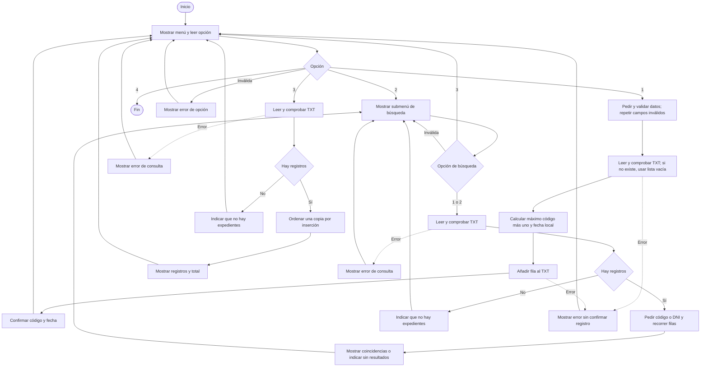

# Diseño del prototipo

Versión documentada: registro, búsqueda y listado en consola.
Este documento describe el código implementado; el equipo debe contrastarlo
con el FUT y el proceso observado antes de incorporarlo al informe final.

## Entradas, procesos y salidas

| Entradas | Procesos | Salidas |
|---|---|---|
| Nombres, apellidos, DNI, tipo y asunto | Validar, generar código y fecha, añadir al TXT | Confirmación y código asignado |
| Código completo o DNI | Leer TXT y buscar secuencialmente | Datos coincidentes o mensaje sin resultados |
| Opción de listar | Leer TXT y ordenar por inserción | Expedientes por código ascendente y total |

## Campos del archivo

Una fila por expediente, UTF-8, siete campos separados por `|`:

| Posición en la lista | Campo | Regla |
|---|---|---|
| 0 | Código | Automático: `EXP-0001`; siguiente al mayor número guardado |
| 1 | Nombres | Obligatorio; sin `|` ni saltos de línea |
| 2 | Apellidos | Obligatorio; sin `|` ni saltos de línea |
| 3 | DNI | Texto de ocho dígitos ASCII; conserva ceros iniciales |
| 4 | Tipo | Constancia de estudios, certificado de estudios, constancia de matrícula, libreta u otro especificado |
| 5 | Asunto | Texto obligatorio; sin `|` ni saltos de línea |
| 6 | Fecha | Automática según el reloj local, formato `AAAA-MM-DD` |

Ejemplo ficticio:

```text
EXP-0001|Ana|Torres|00123456|Constancia de estudios|Solicitud para beca|2026-10-22
```

Validar el formato del DNI no verifica la identidad del solicitante.
Un mismo DNI puede tener varios expedientes. El archivo se ubica en
`datos/expedientes.txt`, relativo a los archivos del programa.

## Organización del código

| Archivo | Responsabilidad |
|---|---|
| `main.py` | Menú principal y selección de operaciones |
| `registro.py` | Ingreso y validación; selección del tipo de solicitud |
| `archivos.py` | Lectura, comprobación de estructura, generación de código y guardado |
| `consultas.py` | Submenú de búsqueda, presentación y ordenamiento |

Se usan condiciones para validar, bucles para repetir y recorrer, funciones
con parámetros y retorno, cadenas para separar campos y listas de listas
para representar registros. En Python las listas cumplen aquí el papel de
colecciones indexadas trabajado con arreglos en el curso; no se implementaron
arreglos paralelos específicos.

## Diagrama de flujo general



## Pseudocódigo

```text
PRINCIPAL
    REPETIR
        MOSTRAR menú
        LEER opción
        SEGÚN opción
            1: REGISTRAR
            2: SUBMENÚ_BUSCAR
            3: LISTAR
            4: FINALIZAR
            OTRO: MOSTRAR opción inválida
    HASTA opción = 4

REGISTRAR
    PEDIR nombres y apellidos; repetir hasta que sean válidos
    PEDIR DNI; repetir hasta tener ocho dígitos del 0 al 9
    MOSTRAR tipos; repetir hasta elegir opción válida
    SI tipo = Otro: PEDIR especificación válida
    PEDIR asunto válido
    OBTENER fecha del sistema local
    LEER_Y_COMPROBAR_ARCHIVO
    SI ocurre error: MOSTRAR error y VOLVER
    máximo <- 0
    PARA cada expediente
        máximo <- mayor entre máximo y parte numérica del código
    código <- EXP- seguido de máximo + 1, con al menos cuatro cifras
    AÑADIR los siete campos separados por | y salto de línea al TXT
    SI guardado correcto: MOSTRAR confirmación, código y fecha
    SI ocurre error: MOSTRAR error sin confirmar éxito

LEER_Y_COMPROBAR_ARCHIVO
    SI no existe archivo: DEVOLVER lista vacía
    PARA cada línea
        SEPARAR por |
        COMPROBAR siete campos no vacíos
        COMPROBAR código con prefijo EXP- y número positivo no repetido
        SI falla: INFORMAR error e INTERRUMPIR lectura
        AÑADIR campos a lista de expedientes
    DEVOLVER lista

SUBMENÚ_BUSCAR
    REPETIR
        MOSTRAR buscar por código, por DNI o volver
        LEER opción
        SI opción = volver: VOLVER al principal
        SI opción inválida: MOSTRAR error y REPETIR
        LEER_Y_COMPROBAR_ARCHIVO
        SI error: MOSTRAR error y REPETIR submenú
        SI lista vacía: MOSTRAR aviso y REPETIR submenú
        SI por código: PEDIR código no vacío y convertir a mayúsculas
        SI por DNI: PEDIR DNI de ocho dígitos
        encontrados <- 0
        PARA cada expediente
            SI campo elegido coincide exactamente con dato
                MOSTRAR expediente
                encontrados <- encontrados + 1
        MOSTRAR total encontrado o aviso sin coincidencias

LISTAR
    LEER_Y_COMPROBAR_ARCHIVO
    SI error: MOSTRAR error y VOLVER
    SI lista vacía: MOSTRAR aviso y VOLVER
    copia <- COPIAR lista de expedientes
    PARA i desde 1 hasta longitud(copia) - 1
        actual <- copia[i]
        j <- i - 1
        MIENTRAS j >= 0 Y número(copia[j].código) > número(actual.código)
            copia[j + 1] <- copia[j]
            j <- j - 1
        copia[j + 1] <- actual
    MOSTRAR expedientes de copia y total
    NO reescribir TXT
```

## Justificación técnica y límites

La búsqueda secuencial compara registros uno a uno. El ordenamiento por
inserción desplaza registros mayores para colocar cada expediente en su
posición. Se compara la parte numérica para ordenar correctamente incluso
después de `EXP-9999`. Son algoritmos sencillos de explicar para un prototipo
pequeño; el ordenamiento por inserción puede necesitar un número cuadrático
de comparaciones en el peor caso. La comprobación de códigos repetidos
durante la lectura también puede tener costo cuadrático con la lista actual.

El TXT permite persistencia sin un gestor de base de datos. No ofrece
transacciones, control de usuarios, respaldo automático ni coordinación entre
dos programas abiertos simultáneamente. El prototipo está pensado para un
operador y una instancia. Una interrupción durante la escritura puede dejar
una fila incompleta; el lector la detecta, pero no la repara automáticamente.
No debe presentarse como un sistema municipal o escolar listo para producción.

## Pendiente de validación con el equipo

- Confirmar el FUT real y la obligatoriedad de cada campo.
- Determinar cuándo corresponden grado, sección y fechas de estudios.
- Confirmar con el docente si deben demostrarse arreglos paralelos u otros
  mecanismos específicos además de las listas utilizadas.
- Incorporar evidencias de campo, alternativas de solución y su justificación.
- Completar las pruebas con casos derivados de la observación, anonimizados.
- Completar estrategias de aprendizaje, reflexión técnica y ética,
  conocimiento nuevo, informe, presentación y formato de uso de IA del aula.

Estos pendientes no se consideran realizados por disponer de código funcional.
